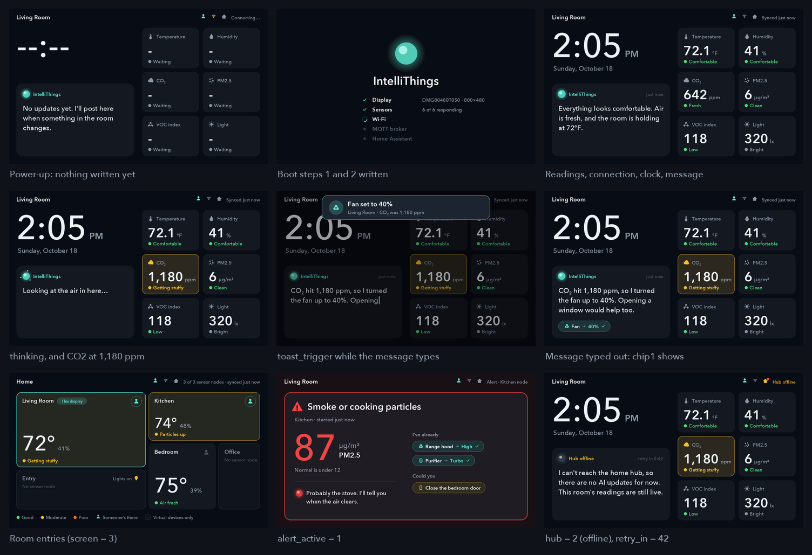

# Companion display: handoff

October 18, 2026 · for the software team, from the display bench

The DWIN **DMG80480T050_09WN** (5", 800×480, no touch) runs the approved display concepts: 13
screen states plus the 24-LED light bar. An ESP32-C6 (the *companion*, the Waveshare
ESP32-C6-LCD-1.47 on the bench) draws them. Until now it played demo data; this handoff is how
the node firmware feeds it real numbers.

## The short version

- The node writes **VPs** (16-bit words at addresses `0x1000`–`0x17FF`) with ordinary DGUS
    write frames, `5A A5 <len> 82 <VP> <data>`. This is the same workflow the firmware
    architecture planned for the `dwin_display` thread. **The table is `VP_MAP.html`.**
- **Where the frames go:** to the companion C6's node link (UART, 115200 8N1, 3.3 V: node TX → **GP2**,
    **GP3** → node RX, GND), not straight to the panel. The companion owns the panel's own VPs.
- **The minimum for a live demo:**
    - the sensor block every second (10 words in one frame, in MQTT snapshot order);
    - `wifi`, `hub` and `synced_ago` when they change;
    - the clock once after SNTP;
    - `message_text` for each `…/display` message.

    The display picks the screen and the light pattern by itself.

- **For the AI message contract (due today):** the AI section shows about **110 characters**
    (4 lines). With action chips it shows about 80 (3 lines). Longer text is cut with “…”.

- No node handy? Try everything from a laptop over the companion's USB:
    `python tools/companion.py --port /dev/cu.usbmodem… play`.



*Every screen above comes only from VP writes: real DGUS frames through the companion's decoder,
drawn by the panel simulator (`cargo run --example live` in `firmware/companion-ui`).*

## What's in the folder

| Path | What |
|---|---|
| `handoff/VP_MAP.html` | **The VP map**: every address, unit, power-up value and value list, with example frames |
| `handoff/vp_map.csv`, `vp_map.json` | The same table for spreadsheets and scripts |
| `handoff/live-screens.png` | The screens the VP writes above produce |
| `handoff/dwin_vp.rs` | Drop-in Rust for the node firmware: every address as a constant, plus `write_frame`, `read_frame`, `text_words`, `x10` and `whole` |
| `tools/companion.py` | Writes VPs by name from a laptop; `play` runs a scripted live demo (a reference for what the node sends) |
| `firmware/companion-ui/` | `no_std` Rust crate: the DGUS driver, screens, light-bar patterns and the VP decoder (`vp.rs`). Host-tested |
| `firmware/companion-node/` | The companion's firmware (esp-hal 1.2.2 + embassy, the same stack as `software/firmware`) |
| `dgus/` | Builds the panel's `DWIN_SET` (backgrounds, 3,894 sprites and glyphs, controls) without DWIN's Windows tool. `dgus/vpmap.py` is the VP map's source |
| `docs/wiring.png` | Bench wiring diagram |
| `build/DWIN_SET/` | The files on the panel's microSD card |
| `README.md` | Bring-up guide, how it works, file formats |

## Wiring on the bench

| From | To | Note |
|---|---|---|
| Bench supply 12.0 V (0.5 A limit) | Display pins 1–2 (+), 7–8 (−) | The panel takes 6–36 V. Never put 12 V on the ESP32 |
| C6 **GP18** (UART1 TX) | Display pin 5 (RX2) | Direct; the panel reads 3.3 V |
| Display pin 4 (TX2) | 1 kΩ → C6 **GP19**, with 2 kΩ from GP19 to GND | TX2 idles at **5 V**; the C6 isn't 5 V tolerant (2 × 560 Ω over 2.2 kΩ also works) |
| Display GND | C6 GND | |
| Node **TX** | C6 **GP2** (node link RX) | 3.3 V to 3.3 V, no divider |
| C6 **GP3** (node link TX) | Node **RX** | For the "OK" replies and reads (optional) |
| Node GND | C6 GND | |
| C6 **GND** | LED strip **GND** | **Required.** Without it the strip's current flows through GP20: random flicker, and it can destroy the C6 |
| C6 **5V** | LED strip **5V** | Under 0.5 A at the firmware's brightness cap. A 470–1000 µF capacitor at the strip helps |
| C6 **GP20** | 330 Ω → LED strip **DIN** | Resistor near the strip. Until a strip is fitted, the C6's RGB LED stands in |

With the Waveshare board screen side up and USB at the top, GP18/19/20 are on the left header.
5V, GND, GP2 and GP3 are on the right header. The display's **ON=TTL** pads are bridged. Change
the LED strip's wires only with the C6 unplugged: GND on first, off last.

## For the software team: plugging in the numbers

1. **Wire the node link** (above), or start from a laptop with `tools/companion.py`.
2. **Copy `handoff/dwin_vp.rs`** into the node firmware (`src/ui/dwin_vp.rs`) and give the
    `dwin_display` task a UART at 115200 baud.
3. **Write the values** (code below).
4. **Check it** (list below).

Writing the values:

```rust
use crate::ui::dwin_vp as vp;

/// Writes `words` at `at`, split into frames of at most 120 words.
async fn send(uart: &mut UartTx<'_, Async>, at: u16, words: &[u16]) {
    let mut buf = [0u8; 6 + vp::MAX_DATA];
    for (k, chunk) in words.chunks(vp::MAX_DATA / 2).enumerate() {
        let n = vp::write_frame(&mut buf, at + (k * vp::MAX_DATA / 2) as u16, chunk);
        let _ = uart.write_all(&buf[..n]).await;
    }
}

// Once at boot: forget whatever an earlier run left on the display.
send(&mut uart, vp::INPUTS_RESET, &[vp::RESET_MAGIC]).await;

// Every second: the whole sensor block in one frame, in MQTT snapshot order.
// x10 for temperature and humidity; NO_READING (0x8000) for a sensor with no value.
send(&mut uart, vp::TEMPERATURE, &[
    vp::x10(Some(s.temp_c)), vp::x10(Some(s.humidity_pct)), s.voc_index, s.co2_ppm,
    vp::whole(Some(s.lux)), s.distance_mm, s.pm1_0, s.pm2_5, s.pm10, s.presence as u16,
]).await;

// Connection state, when it changes; synced_ago = 0 after each publish or message.
send(&mut uart, vp::WIFI, &[wifi_up as u16, hub /* 0 connecting, 1 online, 2 offline */, 0]).await;

// After SNTP: Unix time (high word first) and the UTC offset in minutes.
send(&mut uart, vp::UNIX_TIME, &[(unix >> 16) as u16, unix as u16, (-240i16) as u16]).await;

// Each MQTT …/display message: its ts (0 if none), then the text.
send(&mut uart, vp::MESSAGE_TS, &[(ts >> 16) as u16, ts as u16]).await;
let mut words = [0u16; vp::MESSAGE_TEXT_WORDS];
let n = vp::text_words(&msg.text, &mut words);
send(&mut uart, vp::MESSAGE_TEXT, &words[..n]).await;
```

Checking it:

- The display answers every write with `5A A5 03 82 4F 4B`.
- Reading `0x10F0` (6 words) returns the interface version, the panel state, the screen shown,
  live or demo, and the count of accepted and refused writes.

- The companion's USB log prints a line for any refused write.
- The companion's own screen shows **LIVE** and counts the writes.

**Behaviour to know:**

- The AI text stays until a *different* text arrives. Rewriting the same retained message after
    a reconnect doesn't restart the typing.
- Anything you never write keeps its power-up value. With no presence sensor, the screen never
    dims to the away page.
- Until the first write, the companion plays the demo. `mode` (`0x1038`) can force live or
    demo. `screen` (`0x1037`) forces a page for testing.

**Optional extras**, if the AI contract grows to carry them:

- action chips under the message;
- the “thinking” line with the spinning orb;
- toasts;
- alerts that take over the screen;
- other rooms' readings for the rooms page;
- the boot checklist;
- the Wi-Fi setup page with a QR code.

All are in the VP map.

### Later: one chip instead of two

The bench uses two C6s (node and companion), which keeps the teams independent. For the final
node, the same VPs work in-process:

1. Add `firmware/companion-ui` as a dependency.
2. Keep one `vp::Inputs`.
3. Call `inputs.write(vp, words, now)` instead of sending frames.
4. Run the frame loop from `firmware/companion-node/src/bin/main.rs`: `inputs.apply(...)`,
    `director.decide(...)`, then `ui.frame(...)`.

The VP map stays the contract either way.

## Building, flashing, loading

```bash
make setup                 # once: Python venv
make dwin                  # build/DWIN_SET + firmware tables + the VP map files in handoff/
make test                  # Python and Rust tests
make flash                 # build and flash the companion firmware to the C6 on USB
make firmware              # build/companion-node.elf, to flash without Rust (flash.txt)
make sd DISK=/dev/diskN    # format a microSD card and copy DWIN_SET (erases it!)
```

**Loading the panel** (only when `make dwin` changed the `DWIN_SET` files):

1. Power off and insert the card.
2. Power on and wait for **"SD card process end"**.
3. Power off, remove the card, power on.

The panel keeps the files in its flash. Rust: `rustup target add riscv32imac-unknown-none-elf`
and `cargo install espflash`.

## What's verified

On the hardware:

- The panel (DGUS 0x65, OS 0x22) loads the generated `DWIN_SET`.
- A full 104 s loop of all 13 screens ran with every write frame acknowledged and no receive
    errors.
- The redraw behaviour was checked with `paneltest`: moving or removing icons leaves no ghosts
    and doesn't wipe other layers.

In tests:

- The VP map has no overlaps (checked when generated).
- 41 Rust tests pass: frame parsing and resync, every block of the map, text decoding, rooms
    judging themselves, the boot checklist, reset, read-only words, and a round trip through
    `dwin_vp.rs`.
- `cargo run --example live` sends real frames through the parser and decoder for nine
    situations. The panel simulator draws them as expected (the picture at the top).
- `tools/companion.py` (`status`, `set`, `get`, `message`, `play`, `reset`) ran against the
    decoder on the computer, inside the firmware's frame loop. `play` made about 210 writes,
    none refused, and walked boot → home → sensors → rooms → alert → home.

**Not yet tried on the bench:**

- the VP input on the real companion: the firmware is built and tested on the computer, but not
    flashed yet;
- a real node on the node link (a USB-UART adapter on GP2/GP3 is a good first step);
- the LED strip with the current firmware. A first try flickered at random. Part of that was
    the firmware: it sent the strip's bits from an async task, and a busy screen task made it
    miss refills. It now sends each frame with interrupts off (`ledbar.rs`). The test-pattern
    screen (`screen` = 9) holds the bar still in red, green, blue, white for checking the wiring;
- the toast's rounded corners and the brightness scrim behind it.

## Known limits and open items

- **Characters.** Text draws printable ASCII plus `° ₂ µ ³ · … ’ ‘ “ ” – — − ×`. Accents and emoji
    are skipped. Adding characters means a `make dwin` and an SD reload.
- **Room names** on the rooms page are part of the panel's background (`dgus/pages.py`, `ROOMS`).
    Renaming a room needs `make dwin` and an SD reload.
- **Trends** on the sensors page are collected by the companion (one sample per 10 minutes), so
    they restart empty after it reboots.
- **The final PCB** needs a 6–36 V supply for the display and the TX2 divider, or a level shifter.
- **The layout rule.** Page rotation (sensors and rooms pages) is off by default, because those
    pages hide the AI message. `rotate_pages` turns it on.
- **Repo.** Nothing here has been pushed to the team repo. The software lead can copy
    `VP_MAP.html` (or the CSV) into `docs/interfaces/` as the display contract.
